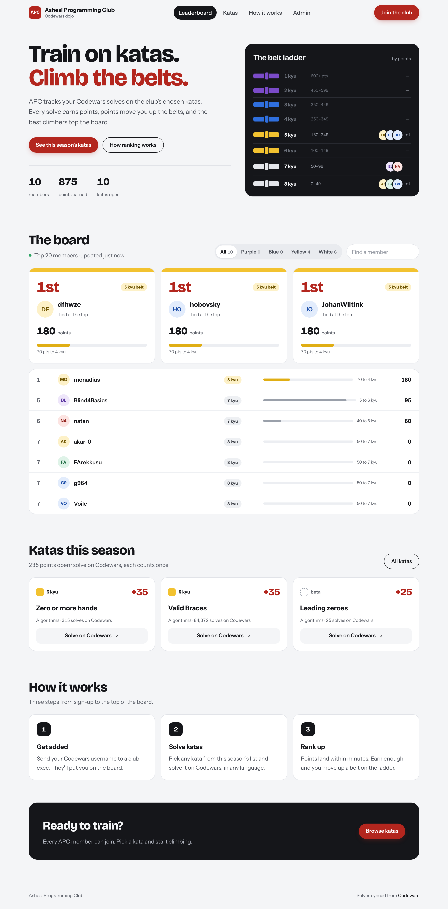
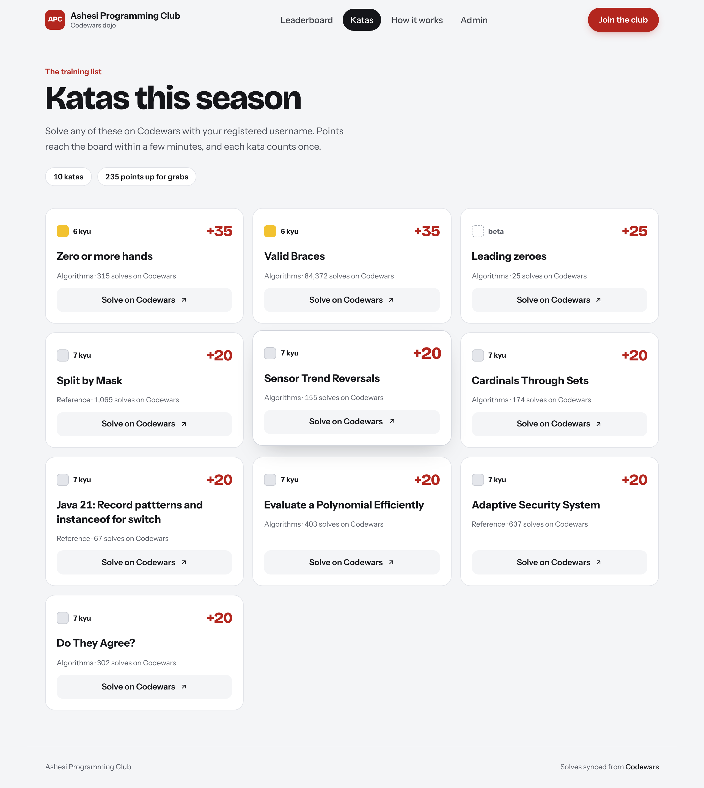
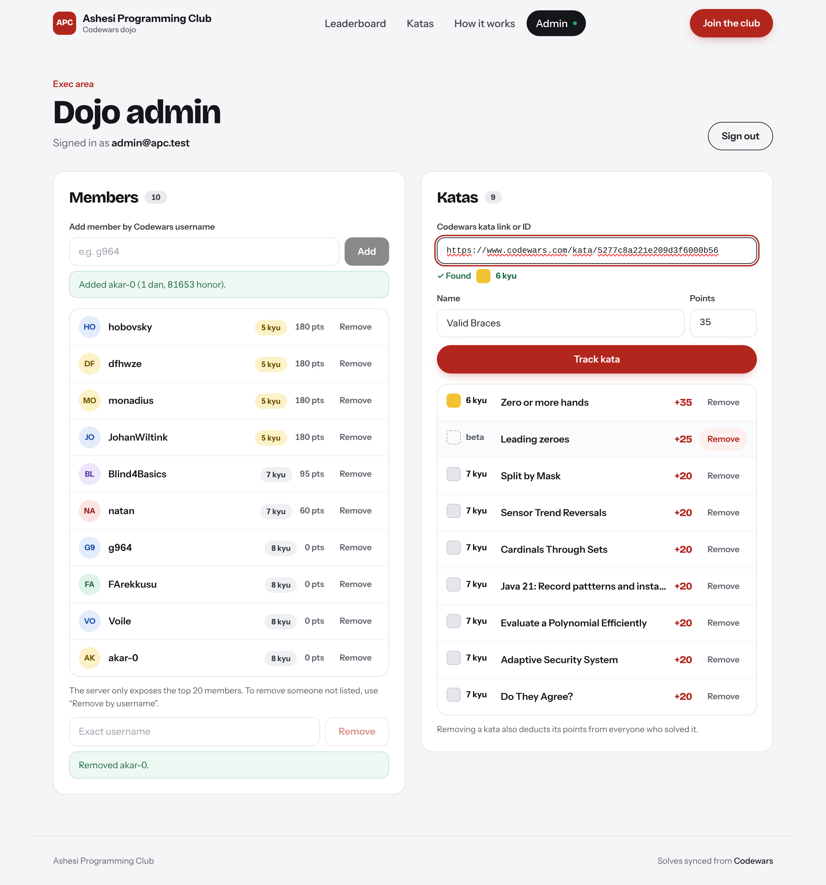
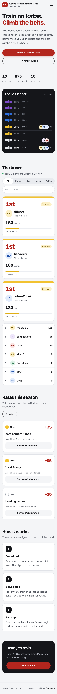

# APC Leaderboard (frontend)

Web UI for the Ashesi Programming Club Codewars leaderboard. It sits on top of the
[APC leaderboard server](https://github.com/Oritsema-Lawson/asc-leaderboardserver) (ASP.NET Core),
which polls Codewars and awards points when tracked members solve tracked katas.

| Leaderboard | Katas | Admin | Mobile |
| --- | --- | --- | --- |
|  |  |  |  |

## Features

- **Belt ladder** – members climb belts (8 kyu → 1 kyu) as they earn points. Belts are computed on the
  frontend from points, so execs can retune the thresholds in [`src/lib/belts.ts`](src/lib/belts.ts).
- **The board** – podium for the top 3 with belt progress, ranked list with tie-aware ranks, belt filter,
  search, live refresh every 30s. When someone's points go up between refreshes their row flashes with a “+N”.
- **Katas** – every tracked kata with its points, Codewars kyu, category and worldwide solve count.
- **How it works** – the three steps from joining to ranking up.
- **Admin** (`/admin`) – sign in / request access, add & remove members, add & remove katas.
  - New members are checked against Codewars so typos can't get tracked.
  - Paste any Codewars kata link — the name, rank and a suggested point value are filled in automatically.
  - Removals need a second click to confirm.
- **Motion** – staggered entrances, scroll reveals, count-up numbers, growing progress bars, hover lifts.
  Everything is switched off for visitors who set “reduce motion” in their OS.

Built with React 19, TypeScript, Vite and Tailwind CSS v4.

## Running locally

1. Start the server (needs the .NET 10 SDK). It listens on `http://localhost:5008`:
   ```sh
   cd asc-leaderboardserver
   dotnet run --launch-profile http
   ```
2. Start the UI:
   ```sh
   npm install
   npm run dev        # http://localhost:5173
   ```
   If the server runs somewhere else, copy `.env.example` to `.env.local` and set `API_PROXY_TARGET`.

### Creating the first admin

The server creates new accounts with the `UNSPECIFIED` role. Register on `/admin` → "Request access",
then promote the account in the server's SQLite DB:

```sh
sqlite3 APCMain.db "UPDATE UserAuth SET PermissionLevel='ADMIN' WHERE UserEmail='you@example.com';"
```

## Deploying

The server authenticates with an `HttpOnly`, `SameSite=Strict` cookie and has no CORS policy, so
**the UI and the API must be served from the same origin**. Pick either option:

- **Reverse proxy** (nginx, Caddy, …): serve `dist/` and forward `/api/*` to the server.
  For example, with Caddy:
  ```
  leaderboard.example.com {
    handle /api/* { reverse_proxy localhost:5008 }
    handle { root * /srv/apc-leaderboard/dist; try_files {path} /index.html; file_server }
  }
  ```
- **Let the server host it**: run `npm run build`, copy `dist/` into the server's `wwwroot/`, and add
  `app.UseDefaultFiles(); app.UseStaticFiles(); app.MapFallbackToFile("index.html");` to `Program.cs`.

Before going live, set `CookieSecurePolicy.Always` on the server (see the comment in its `Program.cs`) and serve over HTTPS.

## Scripts

| Command | What it does |
| --- | --- |
| `npm run dev` | Dev server with `/api` proxied to the backend |
| `npm run build` | Type-check and build to `dist/` |
| `npm run preview` | Serve the production build locally (also proxies `/api`) |
| `npm run lint` | ESLint |
